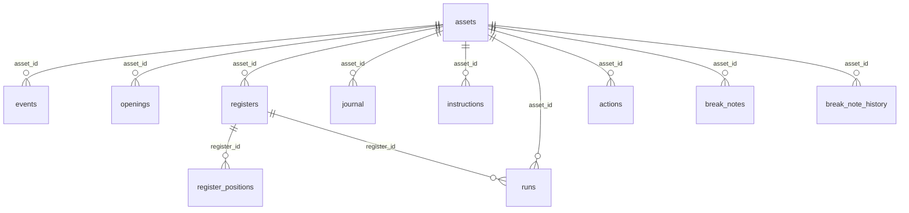
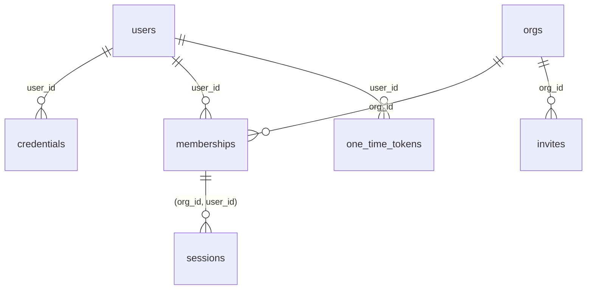
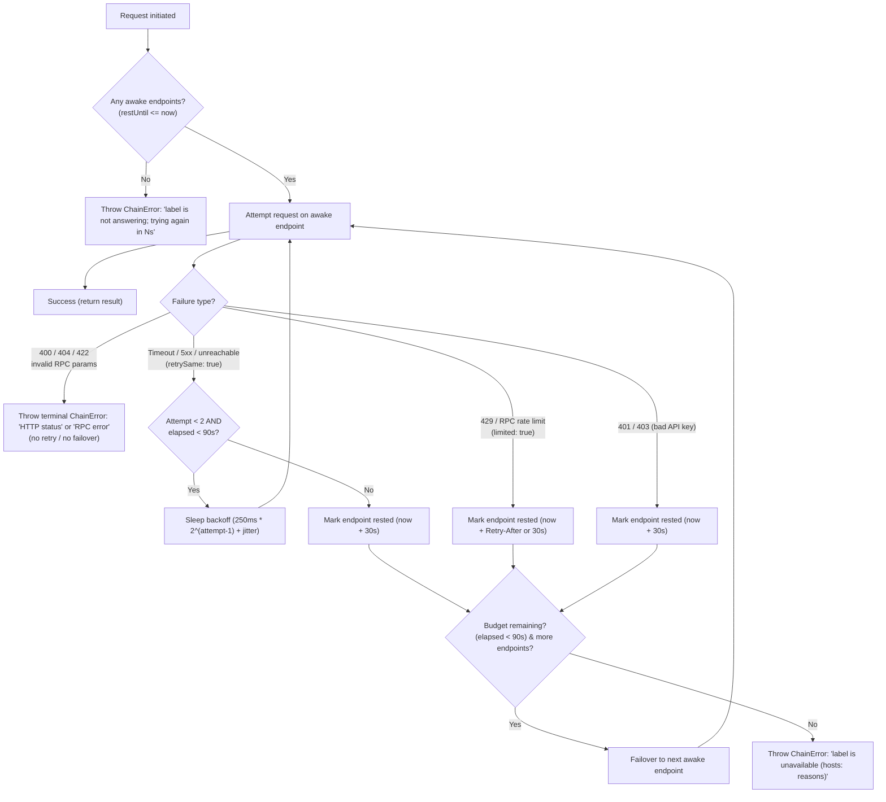

# Architecture

Concord is one Node process: a background indexer, an HTTP API, and the dashboard it serves. It
reads Stellar and compares what it sees with books a user uploads. It never signs or submits
anything.

```
 Stellar RPC (getEvents)  ─┐
 Horizon (opening balances)┴─►  chain.ts ──► events ──┐
                                                      ▼
 CSV: register / journal / instructions ──► core: parse + replay + reconcile
                                                      │ results
                                                      ▼
                                   concord.ts ──► SQLite (one file per workspace)
                                                      ▲
                          api.ts / cli.ts ────────────┘   ◄── dashboard (apps/web)
```

## The three packages

### `packages/core` — the accounting, no I/O

Pure functions over plain data. Nothing here reads a file, a clock, a database or the network;
callers pass everything in. All amounts are `bigint` in the asset's smallest unit.

| Module | Role |
|---|---|
| `events.ts` | `AssetEvent`: the CAP-67 event set (`transfer`, `mint`, `burn`, `clawback`, `set_authorized`) as Concord sees it, and ledger ordering |
| `holdings.ts` | `replay`: events (plus optional opening balances) → `HoldingsState`, the balance, authorisation and supply per address at a point in time |
| `register.ts` | Parse a register CSV into `RegisterPosition`s; report unreadable rows by line |
| `reconcile.ts` | `reconcilePositions`: holdings vs register → position breaks (quantity, missing either side, unmapped holder, status, supply, incomplete history) |
| `movements.ts` | Parse a journal; `reconcileMovements`: on-chain movements vs journal entries |
| `distributions.ts` | Corporate actions: dividend and split entitlements from record-date holdings, `observeFlows` from the ledger, `reconcileDistribution` between them |
| `controls.ts` | Parse instructions; `buildControlsLog` matches each freeze, authorisation or clawback to an instruction issued in the 72 hours before it |
| `amount.ts`, `csv.ts` | Exact decimal parsing and formatting; RFC 4180 CSV |

A break has a stable `key` (for example `STATUS_MISMATCH:<address>`). Sign-offs attach to that key
and record the figures they were written against, which is how a sign-off knows to reopen when
the break moves.

### `services/api` — I/O and orchestration

| File | Role |
|---|---|
| `chain.ts` | `ChainSource` interface and `StellarSource`. Pages RPC `getEvents`, decodes them with `decodeEvent`, fails over between endpoints, and reads Horizon for opening balances. Also `resolveAsset` (`CODE:ISSUER` or a `C...` contract id) |
| `concord.ts` | The `Concord` class for one workspace: watch/unwatch/rebuild assets, `sync`, import books, `reconcile`, corporate actions, sign-off notes, controls, `auditExport` |
| `tenants.ts` | Opens a workspace's `Concord` on demand. One SQLite file per workspace under `data/orgs/` |
| `db.ts`, `schema.ts` | Thin wrapper over `node:sqlite` (WAL mode) and the migration lists |
| `auth.ts`, `auth-api.ts`, `security.ts` | Accounts, memberships, sessions, invitations, reset links, Google sign-in, scrypt password hashing, signed cookies, rate limiting |
| `api.ts` | The Hono routes. Rejects cross-origin requests; every call carries the workspace in `x-concord-org` |
| `main.ts` | Builds the runtime, serves the built dashboard, starts the indexer loop (`CONCORD_SYNC_INTERVAL`) |
| `cli.ts` | The `pnpm concord` commands, operating on the same data directory as the server |
| `demo/testnet.ts` | Development tool: issues a practice regulated asset on testnet and writes books that disagree with the chain in known ways |

### `apps/web` — the dashboard

React 19, Vite and Tailwind 4. `api.ts` is the only place that talks to the server. Tabs under
`src/tabs` are per-asset views (reconciliation, holdings, events, corporate actions, controls,
export); `Settings.tsx` and `Auth.tsx` cover workspace and sign-in. In production the API serves
the built files from the same origin, so there is no CORS and the session cookie is `SameSite=Strict`.

## Data

Two kinds of database, all under `CONCORD_DATA_DIR`:

- `control.db`: users, workspaces, memberships, sessions, invitations. Schema is
  `CONTROL_MIGRATIONS`.
- `orgs/<id>.db`: one per workspace, so nothing a workspace stores can be reached through another.
  Schema is `ORG_MIGRATIONS`: watched assets, indexed events, uploaded registers, journals,
  instructions, reconciliation runs, corporate actions, notes.

### Workspace database layout (`orgs/<id>.db`)



Foreign keys enforce referential integrity (`PRAGMA foreign_keys = ON`). All relationships cascade:
- Deleting an asset (`assets`) automatically cascades to delete all its `events`, `openings`, `registers` (and their `register_positions` and `runs`), `journal`, `instructions`, `actions`, `break_notes`, and `break_note_history`.
- Deleting a register (`registers`) cascades to delete its `register_positions` and all reconciliation `runs` generated against it.
- `meta` stores workspace configuration and stands alone without foreign keys.

### Control database layout (`control.db`)



Cascades manage identity lifecycles:
- Deleting an organization (`orgs`) cascades to delete its `memberships`, `invites`, and associated `sessions`.
- Deleting a user (`users`) cascades to remove their `credentials`, `memberships`, `sessions`, and `one_time_tokens`.
- `sessions` holds a composite foreign key on `(org_id, user_id)` referencing `memberships(org_id, user_id) ON DELETE CASCADE ON UPDATE CASCADE`, ensuring sessions are strictly scoped to active workspace memberships.

### Columns holding derived JSON blobs

Several columns store derived structured data as serialized JSON text (`services/api/src/concord.ts`):

| Table | Column | Shape / Type | Description |
|---|---|---|---|
| `assets` | `ignore_addresses` | `string[]` | Addresses omitted from balance and reconciliation calculation (e.g. issuer or distributor accounts). |
| `registers` | `issues` | `Array<{ line: number; message: string }>` | Parsing issues or validation warnings encountered when importing the register CSV. |
| `runs` | `result` | `ReconcileRunResult` | Full reconciliation outcome, including position breaks, movement breaks, summary totals, and holdings snapshot. |
| `actions` | `params` | Corporate action terms object | Specific parameters for the corporate action (e.g. `{ dividendRate, payAsset }` or `{ splitNumerator, splitDenominator }`). |
| `actions` | `snapshot` | `Record<string, string>` | Map of account addresses to integer balance strings (in smallest units) captured at the action's record time. |
| `actions` | `result` | Corporate action reconciliation object | Detailed distribution results: observed vs expected entitlements, diffs, and execution breaks. |

### Why amounts are stored as TEXT

All currency and token quantities in database columns (`events.amount`, `openings.amount`, `register_positions.units`, `journal.units`, `instructions.units`) are stored as `TEXT`:
- Values represent exact decimal strings of the asset's *smallest unit* (e.g. integer stroops on Stellar).
- SQLite's numeric types (`INTEGER` up to 64-bit signed, `REAL` IEEE-754 double) risk precision loss or overflow when handling large integer quantities or 128-bit Soroban token balances.
- Storing balances as decimal strings guarantees zero loss of precision. The asset's `assets.decimals` defines the fractional exponent for display.
- Inside JSON objects (`runs.result`, `actions.result`), amounts are formatted for human readability as decimal strings in whole units (e.g. `"100.5"`), while `actions.snapshot` retains smallest-unit integer strings.

### Cache invalidation with `PRAGMA data_version`

`Concord` instances cache in-memory `HoldingsState` in `stateMemo` (`services/api/src/concord.ts#L270-L292`).
- When a local operation alters an asset, it calls `touch(assetId)` to invalidate that asset's cached entry.
- When multiple processes access the same database file (such as the API server and the CLI), `fresh()` queries SQLite's `PRAGMA data_version` via `db.dataVersion()`.
- SQLite increments `data_version` whenever an external connection commits a change to the database file. If `version !== seenVersion`, `fresh()` clears all memoized entries in `stateMemo`, ensuring readers never serve stale cached balances.

### Migration rules

- Schemas are defined as ordered migration arrays in `services/api/src/schema.ts` (`ORG_MIGRATIONS` and `CONTROL_MIGRATIONS`).
- `PRAGMA user_version` tracks the number of migrations applied.
- Migrations are strictly append-only: never edit or remove an existing migration that has shipped.
- Every new migration requires a committed upgrade fixture under `services/api/test/fixtures/db/` (generated with `make-db-fixtures.ts`). Unit tests in `migrations.test.ts` verify that databases from previous versions upgrade cleanly.

## How the main flows work

**Watching an asset.** `watchAsset` resolves the spec, then asks the chain source for a baseline.
A classic asset starts from every trustline's balance (Horizon) at a ledger, then takes events
from there, because RPC keeps only about seven days. A contract token has no baseline, so its
holdings count from the oldest ledger RPC retains, and the dashboard says so.

**Indexing.** `sync` reads events after the stored cursor and appends them. If the cursor has
fallen out of RPC retention, events were lost: Concord stops indexing that asset and reports the
gap; `rebuild` takes a fresh baseline and keeps the uploaded books.

**Reconciling.** Importing a register triggers `reconcile`: replay events to the register's
`as_of`, compare with `reconcilePositions`, add `reconcileMovements` if a journal exists, store
the run. Nothing reconciles on a timer.

**Corporate actions.** An action records terms (dividend rate, split ratio) and a record time.
Once the chain has passed that time, `reconcileAction` takes holdings at the record time,
computes expected entitlements, observes the actual flows in the execution window, and diffs
them. An action recorded ahead of its record time is picked up by `reconcileDue`.

## Endpoint failover and resilience

Concord queries Stellar RPC and Horizon endpoints across both networks. To handle temporary network faults, node restarts, and provider rate limits, `StellarSource` delegates outbound calls to an `EndpointPool` (`services/api/src/chain.ts#L240-L286`). The pool manages endpoint health, executes retries, rotates through backup endpoints, and enforces cooldown periods.

### State flow



### Constants and configuration

The failover thresholds and timing budgets are defined in `services/api/src/chain.ts#L213-L223`:

| Constant | Value | Role | Source |
|---|---|---|---|
| `ATTEMPT_TIMEOUT_MS` | `20_000` (20s) | Timeout for standard single requests and small responses | `services/api/src/chain.ts#L213` |
| `PAGE_TIMEOUT_MS` | `60_000` (60s) | Extended timeout for large payloads (full pages of events or accounts) | `services/api/src/chain.ts#L215` |
| `ATTEMPTS_PER_ENDPOINT` | `2` | Number of attempts allowed on the same endpoint before failing over | `services/api/src/chain.ts#L216` |
| `PAGE_ATTEMPTS` | `3` | Attempts at a single page of a multi-page read before aborting | `services/api/src/chain.ts#L218` |
| `REST_MS` | `30_000` (30s) | Default cooldown period when an endpoint fails or rate limits without `Retry-After` | `services/api/src/chain.ts#L219` |
| `MAX_REST_MS` | `900_000` (15m) | Maximum cooldown duration accepted from a provider's `Retry-After` header | `services/api/src/chain.ts#L221` |
| `BUDGET_MS` | `90_000` (90s) | Overall wall-clock budget for an operation across all endpoints before giving up | `services/api/src/chain.ts#L223` |

### Failover rules: 429 vs 5xx vs client faults

- **Rate limits (HTTP 429 & JSON-RPC rate limits):** A 429 response or JSON-RPC error (code `-32005` or error text containing "rate limit" / "too many requests") sets `limited: true` and parses any `Retry-After` header (clamped between 1s and 15m; falls back to 30s). The endpoint is rested immediately without retrying on the same URL, and the pool immediately fails over to the next awake endpoint.
- **Transient server faults (HTTP 5xx, timeouts, network drops):** These set `retrySame: true`. The pool retries the same endpoint once (`ATTEMPTS_PER_ENDPOINT = 2`) with an exponential backoff (`250ms * 2^(attempt-1) + jitter`). If the retry also fails or budget runs out, the endpoint is placed into cooldown for `REST_MS` (30s) and the pool tries the next endpoint.
- **Authentication failures (HTTP 401 / 403):** The endpoint is marked with failure reason `"bad API key"`, rested for `REST_MS` (30s), and the pool fails over to the next endpoint without retrying the same one.
- **Client request rejections (HTTP 400, 404, 422, invalid RPC parameters):** These represent malformed queries or ledger range violations. They throw a terminal `ChainError` (`"rejected"`) immediately: neither retry nor failover is attempted.

### Security: API keys never appear in errors

Provider credentials frequently reside in URL path segments (for example, `https://rpc.example/key/<SECRET>/`) or query parameters. Concord sanitizes all failure messages by extracting only the hostname using `hostOf(url) = new URL(url).host` (`services/api/src/chain.ts#L226`). API keys, path components, and headers never appear in operator logs, dashboard error banners, or downstream error messages.

### User-visible error messages

When endpoint failures surface to the operator, they follow standardized patterns:

| Scenario | Operator Message | Notes |
|---|---|---|
| All endpoints currently resting | `<label> is not answering; trying again in <N>s` | Signals temporary cooldown; `<N>` is the shortest remaining rest duration among configured endpoints. |
| All endpoints failed / budget exhausted | `<label> is unavailable (<host1>: <reason1>; <host2>: <reason2>)` | Lists all attempted hostnames and their sanitized failure reasons (e.g. `timed out`, `unreachable`, `HTTP 502`, `bad API key`, `rate limited`). |
| All endpoints rate limited | `<label> is unavailable (<host1>: rate limited; <host2>: rate limited)` | Carries a dedicated `"rate_limited"` error code when every endpoint failed specifically from rate limiting. |
| Terminal request failure | `HTTP 400` / `HTTP 404` / `HTTP 422` / `Stellar RPC <method>: <message>` | Surface the provider error message without retrying. |

## Audit pack contract

The JSON returned by `GET /api/assets/:id/export` is the artifact auditors keep. Its shape is
published as a versioned JSON Schema: [`audit-pack.schema.json`](./audit-pack.schema.json) (v1).
`services/api/test/service.test.ts` generates a pack from the service fixture, validates it with
Ajv, and snapshots its key paths, so adding or removing a field requires a schema change and a new
schema version.

## Testing

`vitest` in `packages/core` and `services/api`. API tests build a real `Concord` with an in-memory
store and a `FakeChain` (`services/api/test/helpers.ts`), so the suite needs no network and runs
real password hashing at a low cost. The dashboard has no automated tests yet.

## Deliberate limits

Documented in [`docs/limits.md`](./limits.md): RPC history of about seven days, supply understated by
pool/claimable/contract balances for classic assets, one process and one disk, no email ([`docs/adr/0003-no-email.md`](./adr/0003-no-email.md)). Changes
that remove a limit should update that file.
