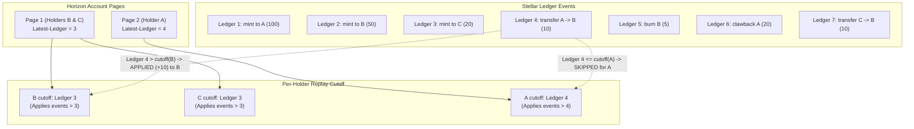

# Opening Balances (Baselines)

Concord watches classic Stellar assets by establishing an opening baseline from Horizon and streaming subsequent CAP-67 events from Soroban RPC. This document explains how opening baselines work across multiple Horizon pages, why each holder requires an individual `asOfLedger` cutoff, a step-by-step worked example, and the architectural blind spots of baseline ingestion.

---

## Why Baselines are Necessary

Stellar Soroban RPC nodes retain approximately seven days of events (~100,000 to 120,000 ledgers). Replaying history from genesis through standard RPC endpoints is not possible because historical events prior to `head.oldest` are pruned.

To index a classic asset that has existed for months or years, Concord establishes opening balances (`openings`) from Stellar Horizon account trustlines at the current ledger, then replays RPC events from that ledger forward.

---

## Horizon Paging and the Moving Ledger

When Concord fetches trustlines for a classic asset (`services/api/src/chain.ts#L500-L525`), it queries Horizon:

```http
GET /accounts?asset=CODE:ISSUER&limit=200&order=asc
```

For assets with more than 200 holders, Horizon returns the list across multiple pages. Each HTTP response includes a `Latest-Ledger` response header (`services/api/src/chain.ts#L535`), identifying the exact ledger sequence at which that specific page was rendered by Horizon.

Because Stellar produces a new ledger roughly every five seconds, **the ledger advances while Concord is reading pages**:
- Page 1 might be served at ledger 100.
- Page 2 might be served at ledger 101 or 102.

A naive single cutoff ledger (such as taking the ledger from the first or last page for all holders) creates a race condition:
- If we choose ledger 100 as the cutoff for everyone, an event occurring at ledger 101 that affects an account returned on Page 2 (whose balance was already calculated at ledger 101 or 102) would be applied a second time during event replay, causing double-counting.
- If we choose ledger 102 as the cutoff for everyone, an event occurring at ledger 101 that affects an account returned on Page 1 (whose balance was calculated at ledger 100) would be skipped during event replay, causing missing funds.

---

## The Solution: Per-Holder `asOfLedger` Cutoff

To ensure strict correctness across advancing pages, Concord tags every individual opening balance with the exact `asOfLedger` of the page on which it was returned (`services/api/src/chain.ts#L514`, `packages/core/src/holdings.ts#L9-L13`):

```ts
export interface Opening {
  amount: bigint;
  authorized?: boolean;
  asOfLedger: number;
}
```

During event replay (`packages/core/src/holdings.ts#L89-L115`), Concord checks the cutoff **per holder address**:

```ts
const cutoff = (address: string) => opening?.get(address)?.asOfLedger ?? baselineLedger;

for (const { address, delta } of effects(ev)) {
  if (ev.ledger <= cutoff(address)) continue;
  const next = (balances.get(address) ?? 0n) + delta;
  balances.set(address, next);
}
```

- Any event that occurred at or before a holder's `asOfLedger` is skipped for that holder because it is already reflected in their Horizon balance.
- Any event that occurred after a holder's `asOfLedger` is applied to their balance.

---

## Timeline Diagram



---

## Worked Example: Three Holders on Two Pages

Consider an asset with three holders: Alice (`A`), Bob (`B`), and Carol (`C`).

### 1. On-Chain History

| Ledger | Event | Details | State on Chain |
|---|---|---|---|
| **1** | `mint` | To A: `100` units | A: 100, B: 0, C: 0 |
| **2** | `mint` | To B: `50` units | A: 100, B: 50, C: 0 |
| **3** | `mint` | To C: `20` units | A: 100, B: 50, C: 20 |
| **4** | `transfer` | From A to B: `10` units | A: 90, B: 60, C: 20 |
| **5** | `burn` | From B: `5` units | A: 90, B: 55, C: 20 |
| **6** | `clawback` | From A: `20` units | A: 70, B: 55, C: 20 |
| **7** | `transfer` | From C to B: `10` units | A: 70, B: 65, C: 10 |

### 2. Horizon Ingestion Across Advancing Pages

While the asset is being ingested:
1. **Page 1 is fetched at Ledger 3:**
   - Horizon returns accounts `B` and `C`.
   - `B` balance = `50`, `asOfLedger = 3`.
   - `C` balance = `20`, `asOfLedger = 3`.
2. **Ledger 4 closes:**
   - Event `transfer` from `A` to `B` (10 units) is committed to the blockchain.
3. **Page 2 is fetched at Ledger 4:**
   - Horizon returns account `A`.
   - `A` balance = `90` (already reflects the 10 units transferred to `B`), `asOfLedger = 4`.

### 3. Event Replay with Per-Holder Cutoffs

When `replay()` evaluates the event stream:

| Event | Ledger | Effect on Holder | Cutoff Comparison | Action & Balance Result |
|---|---|---|---|---|
| `mint to A (100)` | 1 | A: +100 | $1 \le \text{cutoff}(A)=4$ | **Skipped** for A |
| `mint to B (50)` | 2 | B: +50 | $2 \le \text{cutoff}(B)=3$ | **Skipped** for B |
| `mint to C (20)` | 3 | C: +20 | $3 \le \text{cutoff}(C)=3$ | **Skipped** for C |
| `transfer A -> B (10)` | 4 | A: -10 | $4 \le \text{cutoff}(A)=4$ | **Skipped** for A (already subtracted in opening balance of 90) |
| | 4 | B: +10 | $4 > \text{cutoff}(B)=3$ | **Applied** to B: $50 + 10 = \mathbf{60}$ |
| `burn from B (5)` | 5 | B: -5 | $5 > \text{cutoff}(B)=3$ | **Applied** to B: $60 - 5 = \mathbf{55}$ |
| `clawback from A (20)` | 6 | A: -20 | $6 > \text{cutoff}(A)=4$ | **Applied** to A: $90 - 20 = \mathbf{70}$ |
| `transfer C -> B (10)` | 7 | C: -10 | $7 > \text{cutoff}(C)=3$ | **Applied** to C: $20 - 10 = \mathbf{10}$ |
| | 7 | B: +10 | $7 > \text{cutoff}(B)=3$ | **Applied** to B: $55 + 10 = \mathbf{65}$ |

### 4. Resulting Holdings

- **Alice (`A`):** `70` units
- **Bob (`B`):** `65` units
- **Carol (`C`):** `10` units
- **Total Circulating Supply:** `145` units

These figures match the core replay test suite (`packages/core/test/core.test.ts#L413-L421`). Notice how the transfer at Ledger 4 was skipped for Alice (preventing double-deduction) while being applied to Bob (preventing missed funds).

---

## What a Baseline Cannot See (Blind Spots)

Horizon's `/accounts` endpoint only enumerates standard Stellar account trustlines. Consequently, an opening baseline cannot observe classic asset balances held in specialized protocol entries:

1. **Liquidity Pools:** Balances deposited in Automated Market Maker (AMM) pools (`liquidity_pool` reserves).
2. **Claimable Balances:** Balances held in claimable balance entries awaiting claims by designated recipients.
3. **Smart Contracts:** Classic assets deposited into Soroban smart contracts via the Stellar Asset Contract (SAC).

### Impact on Accounting
Because these balances are omitted from Horizon's `/accounts` response:
- Concord's baseline total supply will **understate total circulating supply** by the amount locked in liquidity pools, claimable balances, and smart contracts at the time of the baseline snapshot.
- Once an asset is being indexed, subsequent events (such as mints, burns, or transfers to/from accounts) update balances normally, but holdings prior to the baseline ledger cannot be queried without a full archival node.
