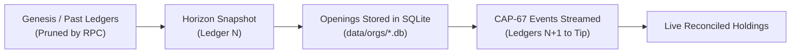
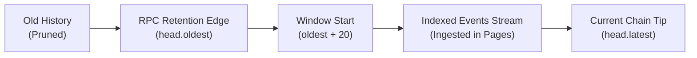
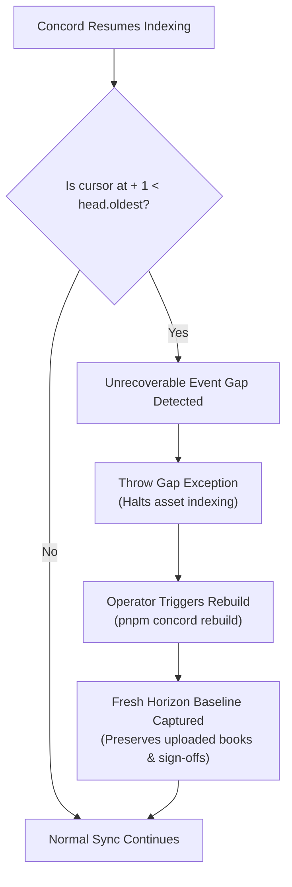

# History, Baselines, and RPC Retention

This document explains how Concord reconstructs asset state from Stellar ledger history, why baselines are necessary, the operational constraints of RPC retention, and how gaps are detected and repaired.

---

## The Stellar RPC Retention Window

Stellar Soroban RPC nodes expose live ledger state and historical event queries (`getEvents`, `getLatestLedger`). To maintain predictable disk footprints across the validator network, standard RPC nodes maintain a rolling window of historical event data covering approximately seven days (~100,000 to 120,000 ledgers at 5 seconds per ledger).

Ledgers older than `head.oldest` have their events pruned by the node. Without specialized archive nodes, replaying every transaction from genesis is neither fast nor possible through standard RPC endpoints. Concord operates within this reality using opening baselines and windowed event tracking.

---

## Timelines and Ingestion Modes

### 1. Classic Assets: Baseline Mode

Classic Stellar assets (assets with an alpha code and issuer public key) use **baseline mode** (`startMode: "baseline"`, `services/api/src/concord.ts#L357`).



When an asset is watched:
1. Concord queries the Stellar Horizon API (`GET /accounts?asset=<code>:<issuer>&limit=200`) across all paged account records (`services/api/src/chain.ts#L376-L442`).
2. Each account's authorized balance is saved as an `Opening` record in the `openings` table (`services/api/src/concord.ts#L393-L412`).
3. Horizon records the specific ledger sequence at which the snapshot was taken (`baseline.ledger`).
4. Concord sets `start_ledger = baseline.ledger + 1` and streams subsequent CAP-67 events (`transfer`, `mint`, `burn`, `clawback`, `set_authorized`) forward from the RPC event endpoint.

### 2. Contract Tokens: Window Mode

Soroban SEP-41 contract tokens that do not wrap a classic asset have no Horizon trustline ledger (`startMode: "window"`, `services/api/src/concord.ts#L357`).



Because contract accounts cannot be enumerated from Horizon:
1. History begins inside the current RPC retention window at `start_ledger = Math.min(oldest + 20, latest)` (`services/api/src/concord.ts#L423-L430`). A 20-ledger buffer prevents race conditions at the sliding retention boundary.
2. Concord tracks all event movements within this active window.
3. The dashboard and audit exports explicitly note that holdings count movements only since `history_from`.

---

## Scope and Blind Spots: What Opening Balances Omit

Horizon's `/accounts?asset=...` endpoint reports balances for standard account trustlines. Consequently, an opening baseline reflects only direct account positions and omits:

1. **Liquidity Pools:** Balances deposited into AMM liquidity pools (`liquidity_pool` reserves).
2. **Claimable Balances:** Balances locked in pending claimable balance entries awaiting receiver claims.
3. **Smart Contracts:** Classic tokens deposited into Soroban smart contracts via the Stellar Asset Contract (SAC).

As a result, Concord's opening balance total for classic assets understates total circulating supply by whatever amounts are currently held in pools, claimable balances, or contracts. Holdings prior to the baseline ledger cannot be reconstructed without historical archives.

---

## Gap Detection and Rebuild

If the Concord indexer is offline or stopped for longer than the RPC retention window (longer than ~7 days), the RPC node prunes events that occurred between the last indexed ledger and the current `head.oldest`.



### Detection Logic
During each sync pass (`services/api/src/concord.ts#L523-L529`):
```ts
if (ready.cursor) {
  const at = cursorLedger(ready.cursor);
  if (at + 1 < head.oldest) {
    throw new Invalid(
      "Indexing was paused for longer than the network keeps events, so movements in between are missing. Rebuild this asset to start again from fresh opening balances.",
    );
  }
}
```

### Rebuild Process
When a rebuild is invoked (`pnpm concord rebuild <ASSET>` or via the dashboard Settings):
1. Concord clears existing `openings` for the asset (`services/api/src/concord.ts#L462-L485`).
2. A fresh baseline snapshot is fetched from Horizon at the current ledger.
3. `start_ledger` is updated, the cursor is reset to the new baseline, and event streaming resumes from that point forward.
4. Existing uploaded registers, journals, corporate actions, and audit sign-off histories remain intact.
