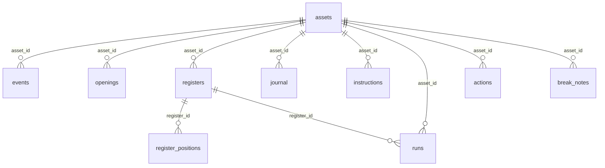
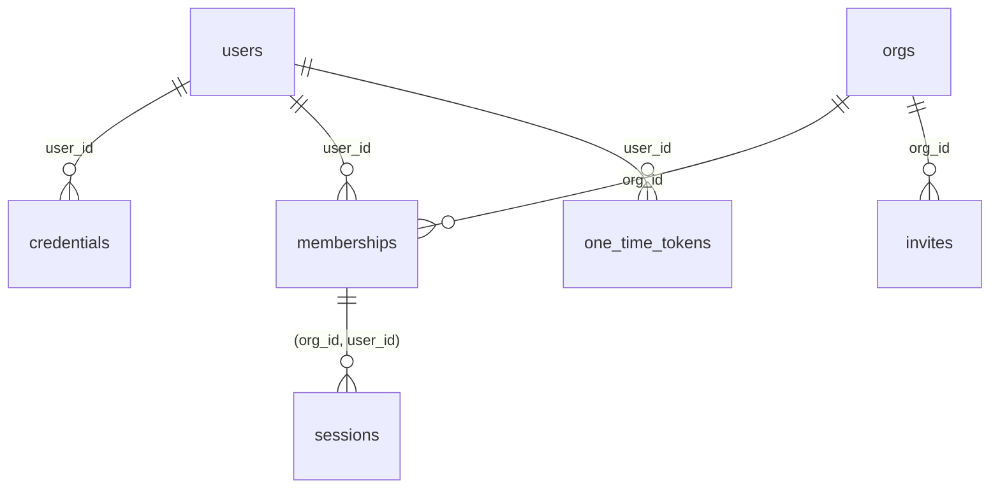

# Database schema

For contributors and data auditors. Concord keeps two kinds of SQLite database under
`CONCORD_DATA_DIR` (see [`data-directory.md`](./data-directory.md) for where they sit on disk):

- `control.db`: identity. Defined by `CONTROL_MIGRATIONS`.
- `orgs/<id>.db`: one per workspace. Defined by `ORG_MIGRATIONS`.

Both lists are in [`services/api/src/schema.ts`](../services/api/src/schema.ts) and are the
source for everything below. This page describes the schema as of one migration in each list.

## Conventions

- **Migrations.** `PRAGMA user_version` is the number of migrations applied. A database newer
  than the build is refused; an unversioned database that already has tables is refused
  (`Db.migrate`, `services/api/src/db.ts`). Migrations are only ever appended to.
- **Foreign keys** are enforced (`PRAGMA foreign_keys = ON` after migration), and the cascades
  below do the deleting: Concord does not delete child rows one by one.
- **Timestamps** are ISO-8601 text in UTC, as produced by `Date.toISOString()` (for example
  `2026-10-06T21:00:00.000Z`). Text order is time order.
- **Amounts in columns** are decimal strings of the *smallest unit* (an integer), not a number.
  `events.amount`, `openings.amount`, `register_positions.units`, `journal.units` and
  `instructions.units` all work this way, and `assets.decimals` says how many of the digits are
  fractional. SQLite would round a large integer stored as a number; a string cannot lose digits.
- **Amounts inside JSON** are different. The stored results of a reconciliation or corporate
  action (`runs.result`, `actions.result`) hold amounts already formatted as decimal strings in
  *whole units*, such as `"1000.5"`. The one JSON exception is `actions.snapshot`, whose holder
  balances are smallest-unit integer strings like the columns.
- **Booleans** are `0`/`1` integers; `NULL` means "not known" where noted.
- **JSON** is stored as `TEXT` and written and read by `JSON.stringify` and `JSON.parse` in
  `services/api/src/concord.ts`. SQLite is not asked to interpret it.
- **Identifiers.** Workspace, user, invitation ids are sixteen lowercase hex characters
  (`newId`, `services/api/src/security.ts`). An asset's id is its Soroban contract id; for a
  classic asset that is the contract of its Stellar Asset Contract (`resolveAsset`,
  `services/api/src/chain.ts`).

## Workspace database (`orgs/<id>.db`)



Every arrow is `ON DELETE CASCADE`. Deleting an asset therefore deletes its events, opening
balances, registers (and through them their positions and runs), journal, instructions, corporate
actions and break notes. Deleting a register deletes its positions *and the runs made from it*.
`meta` stands alone.

### `meta`

| Column | Type | Notes |
|---|---|---|
| `key` | TEXT, PK | Currently only `org_id`. |
| `value` | TEXT | The id of the workspace the file belongs to. Written on first open and checked on every open (`Tenants.forOrg`). |

### `assets`

One row per watched asset.

| Column | Type | Notes |
|---|---|---|
| `id` | TEXT, PK | Contract id. |
| `network` | TEXT | `mainnet` or `testnet` (CHECK). |
| `code` | TEXT | Asset code; for a contract token without a code, a shortened contract id. |
| `issuer` | TEXT, null | Issuer address for a classic asset; `NULL` for a contract token. |
| `name` | TEXT | Display name; defaults to the code. |
| `decimals` | INTEGER | 7 for a classic asset; 0 to 18 for a contract token. |
| `start_mode` | TEXT | How history begins (CHECK): `baseline` (Horizon trustline balances), `ledger` (a ledger the user named), `window` (the oldest ledger the RPC keeps). |
| `state` | TEXT | `indexing` until the start point is established, then `ready` (CHECK; default `indexing`). |
| `start_ledger` | INTEGER, null | First ledger from which events are read. |
| `baseline_ledger` | INTEGER, null | Ledger of the opening balances, for `baseline`. |
| `history_from` | TEXT, null | For `window`: roughly when indexed history begins. |
| `cursor` | TEXT, null | RPC cursor of the last event read. |
| `synced_ledger` | INTEGER, null | Ledger the indexer has reached. |
| `synced_at` | TEXT, null | Close time of that ledger. |
| `sync_error`, `sync_error_at` | TEXT, null | Why the last pass failed, and when. Cleared by a successful pass. |
| `ignore_addresses` | TEXT (JSON) | Array of address strings left out of reconciliation. Default `'[]'`. |
| `created_by` | TEXT, null | Label of the actor who started watching (`cli:<user>` or a session's person). |
| `created_at` | TEXT | |

### `events`

On-chain events (CAP-67) for an asset. Primary key `(asset_id, id)`.

| Column | Type | Notes |
|---|---|---|
| `id` | TEXT | RPC event id, zero-padded so text order is ledger order. |
| `asset_id` | TEXT | → `assets.id` |
| `kind` | TEXT | `transfer`, `mint`, `burn`, `clawback` or `set_authorized` (`EVENT_KINDS`, `packages/core/src/events.ts`). Not constrained in SQL. |
| `ledger` | INTEGER | |
| `closed_at` | TEXT | Ledger close time. |
| `tx_hash` | TEXT | |
| `from_addr`, `to_addr` | TEXT, null | Which are set depends on the kind. For `set_authorized`, `from_addr` is the account affected. |
| `amount` | TEXT | Smallest unit; `0` for `set_authorized`. |
| `authorized` | INTEGER, null | `set_authorized` only: `1` authorised, `0` frozen. |

### `openings`

Opening balances of a classic asset, read from Horizon when the asset is watched or rebuilt.
Primary key `(asset_id, address)`.

| Column | Type | Notes |
|---|---|---|
| `asset_id` | TEXT | → `assets.id` |
| `address` | TEXT | |
| `amount` | TEXT | Smallest unit. |
| `authorized` | INTEGER, null | Trustline authorisation at that ledger, if known. |
| `as_of_ledger` | INTEGER | |

### `registers`

One row per register import. Importing the same file twice gives two rows.
Index `registers_asset (asset_id, as_of)`.

| Column | Type | Notes |
|---|---|---|
| `id` | INTEGER, PK AUTOINCREMENT | |
| `asset_id` | TEXT | → `assets.id` |
| `as_of` | TEXT | The time the register is true for. |
| `source` | TEXT | A label, such as the file name; `upload` if none was given. |
| `sha256` | TEXT | Hash of the CSV text. The CSV itself is not kept. |
| `issues` | TEXT (JSON) | Array of `{ "line": number, "message": string }` for rows that could not be read. |
| `imported_by`, `imported_at` | TEXT | Actor label and time. |

### `register_positions`

One row per holder line in a register. Index `register_positions_register (register_id)`.
There is no primary key; several holders may share one `account` (omnibus).

| Column | Type | Notes |
|---|---|---|
| `register_id` | INTEGER | → `registers.id` |
| `holder_id` | TEXT | |
| `holder_name` | TEXT, null | |
| `account` | TEXT, null | Stellar address; `NULL` when the register has not mapped the holder. |
| `units` | TEXT | Smallest unit. |
| `status` | TEXT, null | `active` or `frozen`; `NULL` if the register does not say. |

### `journal`

The register's transaction journal. Primary key `(asset_id, ref)`; importing an existing `ref`
replaces the row (`INSERT OR REPLACE`).

| Column | Type | Notes |
|---|---|---|
| `asset_id` | TEXT | → `assets.id` |
| `ref` | TEXT | |
| `date` | TEXT | As written in the file, parsed for validity but not normalised. A bare date covers the whole UTC day. |
| `type` | TEXT | `issue`, `transfer`, `redeem` or `clawback`. Not constrained in SQL. |
| `from_addr`, `to_addr` | TEXT, null | |
| `units` | TEXT | Smallest unit. |
| `tx_hash` | TEXT, null | Lower-cased on import. |

### `instructions`

Control instructions a transfer agent issued. Primary key `(asset_id, ref)`; importing an
existing `ref` replaces the row.

| Column | Type | Notes |
|---|---|---|
| `asset_id` | TEXT | → `assets.id` |
| `ref` | TEXT | |
| `type` | TEXT | `authorize`, `freeze`, `unfreeze` or `clawback`. Not constrained in SQL. |
| `account` | TEXT | |
| `units` | TEXT, null | Smallest unit; required for a clawback. |
| `issued_at` | TEXT | |
| `approved_by`, `reason` | TEXT, null | |

### `runs`

One row per reconciliation. Index `runs_asset (asset_id, id)` and `runs_register (register_id)`.

| Column | Type | Notes |
|---|---|---|
| `id` | INTEGER, PK AUTOINCREMENT | |
| `asset_id` | TEXT | → `assets.id` |
| `register_id` | INTEGER | → `registers.id`. NOT NULL: a run always belongs to a register. |
| `as_of` | TEXT | The register's as-of time. |
| `created_by`, `created_at` | TEXT | |
| `result` | TEXT (JSON) | See below. |

`result` holds the whole outcome, so a past run can be shown without recomputing it:

| Key | Meaning |
|---|---|
| `registerId`, `registerSha256` | The register compared, and its hash. |
| `asOf` | Time compared at. |
| `chainLedger`, `chainSyncedAt`, `chainBehind` | The chain state used, and whether the index was behind the register's as-of time. |
| `warnings` | Array of text. |
| `status` | `clean` or `breaks`. |
| `summary` | Totals: `chainSupply`, `registerTotal`, `supplyDifference`, `unmappedUnits`, `grossDifference`, `chainHolders`, `registerHolders`, `lines`, `matchedLines`, `breakCount`. Amounts are whole-unit decimal strings. |
| `lines` | One object per compared position: `address`, `holderIds`, `chainUnits`, `registerUnits`, `difference`, `chainStatus`, `registerStatus`, `matched`. |
| `movement` | `null` without a journal; otherwise the journal-versus-chain comparison for the period, with its own summary and `matches`. |
| `breaks` | Array of break objects (below). |

A break object has `scope` (`position` or `movement`), `type`, `severity`, `key`,
`fingerprint`, `message` and `firstSeen`, and, depending on type, `address`, `holderIds`,
`ref`, `txHash`, `eventId`, `chainUnits`, `registerUnits`, `difference`. `key` identifies
the break across runs; `fingerprint` is text built from the figures the break was raised
against, so it changes when they do.

### `actions`

Corporate actions. Index `actions_asset (asset_id, record_time)`.

| Column | Type | Notes |
|---|---|---|
| `id` | INTEGER, PK AUTOINCREMENT | |
| `asset_id` | TEXT | → `assets.id` |
| `type` | TEXT | `dividend`, `split` or `redemption`. Not constrained in SQL. |
| `label` | TEXT | |
| `record_time` | TEXT | Holdings at this instant are the entitlement basis. |
| `params` | TEXT (JSON) | Terms, below. |
| `snapshot` | TEXT (JSON), null | Set once the indexed chain passes `record_time`: `{ "ledger": number, "takenAt": text, "holders": { "<address>": "<smallest-unit integer>" } }`. Frozen so later reconciliations use the same basis. |
| `result` | TEXT (JSON), null | Reconciliation of the action, below. |
| `created_by`, `created_at` | TEXT | |
| `reconciled_at` | TEXT, null | |

`params` always has `exclude` (array of addresses). A dividend adds `ratePerUnit` (decimal
string, pay-asset units per whole unit held), `payAsset` (the id of a watched asset, which is
the asset itself for an in-kind dividend), `rounding` (`floor` or `half-up`) and, if given,
`payer`. A split or redemption adds `num` and `den` (integer strings). Any action may have
`windowTo`, the end of the execution window. `payAsset` is a value inside JSON, so no foreign key
protects it: unwatching the pay asset leaves a dividend pointing at an id that no longer exists.

`result` has `reconciledThrough`, `warnings`, `status` (`clean` or `breaks`), `flowAsset`
(`{ id, code }` of the asset whose flows were observed), `summary`, `lines` (one per holder:
entitlement against what the ledger showed) and `breaks`, with amounts as whole-unit decimal
strings. Its break objects have the same shape as a run's.

### `break_notes`

Sign-offs on breaks. Primary key `(asset_id, scope, key)`; saving a note for the same break
replaces the old one.

| Column | Type | Notes |
|---|---|---|
| `asset_id` | TEXT | → `assets.id` |
| `scope` | TEXT | `recon`, `controls`, or `action:<id>` for a corporate action of this asset. |
| `key` | TEXT | The break's `key`. |
| `fingerprint` | TEXT | The break's `fingerprint` when the note was written. |
| `status` | TEXT | `open`, `acknowledged` or `resolved`. Not constrained in SQL; the application rejects other values. |
| `note` | TEXT | Required text for anything other than `open`. |
| `author`, `author_id` | TEXT, null | Who signed off, taken from the session, never from the request body. |
| `updated_at` | TEXT | |

A note holds only while the break's current `fingerprint` equals the stored one. If the figures
move, the break shows as open again and the note as stale (`Concord.annotate`).

## Control database (`control.db`)



All of these cascade on delete. Deleting a workspace removes its memberships, and with them the
sessions and invitations. An account left with no membership is deleted by the application
(`Auth.dropStranded`), which removes its credentials and any reset tokens.

### `users`

| Column | Type | Notes |
|---|---|---|
| `id` | TEXT, PK | |
| `email` | TEXT | UNIQUE, case-insensitive (`COLLATE NOCASE`). |
| `name` | TEXT | |
| `email_verified` | INTEGER | Default `0`. Concord sends no email, so addresses are not verified at sign-up. |
| `last_org_id` | TEXT, null | The workspace last used. Not a foreign key. |
| `created_at` | TEXT | |

### `credentials`

Primary key `(user_id, kind)`; a unique partial index on `(kind, subject)` where `subject` is not
null.

| Column | Type | Notes |
|---|---|---|
| `user_id` | TEXT | → `users.id` |
| `kind` | TEXT | `password` or `google`. Not constrained in SQL. |
| `subject` | TEXT, null | The provider's stable id for the user; `NULL` for a password. |
| `secret` | TEXT, null | `scrypt$N$r$p$salt$hash` for a password; `NULL` otherwise. The work factors are stored with each hash. |
| `updated_at` | TEXT | |

### `orgs`

| Column | Type | Notes |
|---|---|---|
| `id` | TEXT, PK | Also the file name of the workspace database. |
| `name` | TEXT | Not unique; the CLI refuses an ambiguous name. |
| `created_at` | TEXT | |

### `memberships`

Primary key `(org_id, user_id)`; index `memberships_user (user_id)`.

| Column | Type | Notes |
|---|---|---|
| `org_id` | TEXT | → `orgs.id` |
| `user_id` | TEXT | → `users.id` |
| `role` | TEXT | `owner` or `member` (CHECK). |
| `created_at` | TEXT | |

### `sessions`

Index `sessions_user (user_id)`.

| Column | Type | Notes |
|---|---|---|
| `id_hash` | TEXT, PK | Hash of the session token. The token itself is not stored. |
| `user_id`, `org_id` | TEXT | Together a composite foreign key → `memberships (org_id, user_id)`, `ON DELETE CASCADE ON UPDATE CASCADE`. A session can only point at a workspace its user belongs to, and ends with the membership. |
| `created_at`, `last_seen_at`, `expires_at` | TEXT | |

### `invites`

Index `invites_org (org_id)`.

| Column | Type | Notes |
|---|---|---|
| `id` | TEXT, PK | |
| `token_hash` | TEXT | UNIQUE. Hash of the link token; the token is returned once and not recoverable. |
| `org_id` | TEXT | → `orgs.id` |
| `email` | TEXT | Case-insensitive. |
| `role` | TEXT | `owner` or `member` (CHECK). |
| `created_by` | TEXT | |
| `created_at`, `expires_at` | TEXT | |
| `accepted_at` | TEXT, null | |

### `one_time_tokens`

| Column | Type | Notes |
|---|---|---|
| `token_hash` | TEXT, PK | Hash of the token. |
| `purpose` | TEXT | `signup` or `reset` (CHECK). |
| `user_id` | TEXT, null | → `users.id`; set for `reset`, `NULL` for `signup`. |
| `note` | TEXT, null | The operator's note on a sign-up code. |
| `created_at`, `expires_at` | TEXT | |
| `used_at` | TEXT, null | Set when spent. |

## Reading the data directly

The databases are plain SQLite and can be opened with the `sqlite3` shell. Open a copy made by
`pnpm concord backup`, not the live files, and never write to a workspace database by hand:
the application's invariants (a run belongs to a register, a note matches a fingerprint) are
kept by code, not by the schema alone.

Smallest-unit amounts need `assets.decimals` to read. To see an event's amount in whole units:

```sql
SELECT e.id, e.kind, CAST(e.amount AS REAL) / pow(10, a.decimals) AS units
FROM events e JOIN assets a ON a.id = e.asset_id;
```

That query uses floating point for display only. For anything you will rely on, keep the integer
string and shift the decimal point as text, as `formatUnits` in `packages/core/src/amount.ts`
does. (`pow` needs an SQLite build with the math functions; if yours lacks them, divide in your
own tool.)
